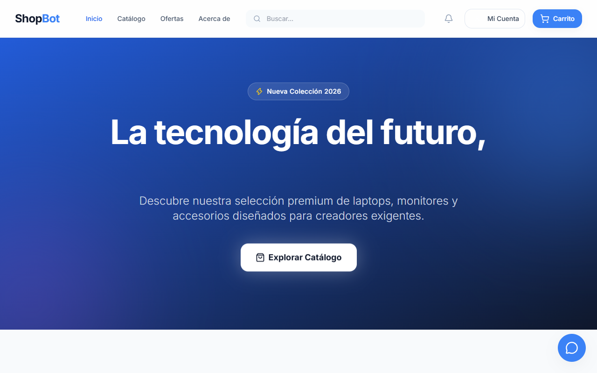
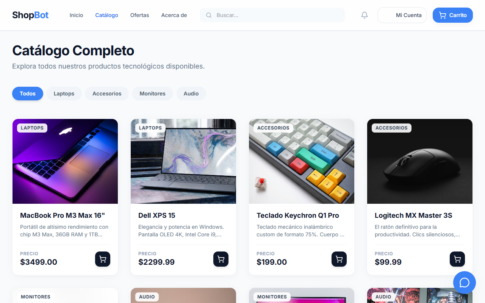
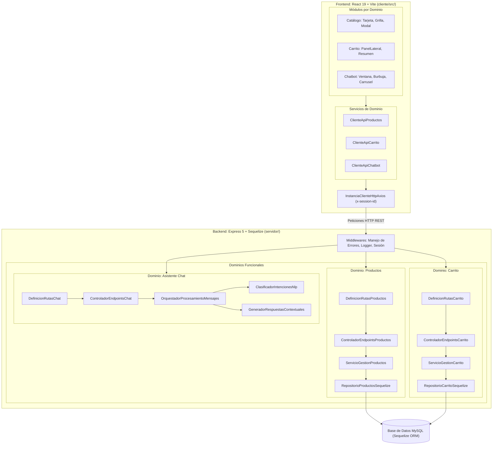

<div align="center">
  
  <h1>ShopBot V3 Ultra</h1>
  <p><b>Plataforma E-Commerce con Asistente Virtual Conversacional (Node-NLP), Arquitectura Modular por Dominios y Cobertura Automatizada de Pruebas.</b></p>
  
  
  
  
  
  
  
  <p>
    <a href="#-inicio-rápido">Inicio rápido</a> ·
    <a href="#-características">Características</a> ·
    <a href="#-arquitectura-modular-por-dominios">Arquitectura</a> ·
    <a href="#-pruebas-automatizadas">Pruebas</a> ·
    <a href="#-documentación-api-swagger">Swagger API</a>
  </p>
</div>

---

## 🎬 Vista Rápida

| Inicio | Catálogo |
|---|---|
|  |  |

---

## ✨ Características y Capacidades

| Característica | Detalle Técnico |
|---|---|
| **Catálogo de Productos** | Listado de productos con filtros por categoría, vista rápida modal y búsqueda parametrizada vía `ClienteApiProductos`. |
| **Carrito Persistente** | Gestión reactiva de carrito ligada a sesión vía cabecera `x-session-id`, cálculo dinámico de subtotales y cantidades. |
| **Autenticación y Cuentas** | Registro y login seguro con sal y hashing criptográfico `scrypt`, contexto reactivo global (`useEstadoSesion`) y persistencia. |
| **Órdenes y Checkout ACID** | Creación de pedidos persistentes (`Ordenes` y `DetallesOrden`), numeración única (`ORD-...`) y vaciado atómico de cesta en una sola transacción. |
| **Asistente Inteligente (NLP)** | Motor `Node-NLP` integrado con clasificación semántica de intenciones (`saludo`, `consulta_producto`, `agregar_carrito`, fallback). |
| **Respuestas Enriquecidas** | El bot retorna texto contextual, opciones rápidas de navegación (chips interactivos) y micro-tarjetas de productos con compra directa. |
| **Documentación Interactiva** | Documentación OpenAPI / Swagger integrada y operativa en `/api-docs`. |
| **Monitoreo y Salud** | Endpoint `/api/salud` para healthchecks en entornos de producción y CI/CD. |

---

## 🏗️ Arquitectura Modular por Dominios

El sistema aplica los principios de **Clean Code**, **SOLID (especialmente DIP)**, **Separation of Concerns** y una estricta **restricción de tamaño de archivos (< 200 líneas)**:



---

## 📁 Estructura del Código Fuente

```text
ShopBot/
├── cliente/src/
│   ├── modulos/
│   │   ├── catalogo/        # TarjetaProductoCatalogo, GrillaProductos, ClienteApiProductos
│   │   ├── carrito/         # PanelLateralCarrito, ClienteApiCarrito
│   │   ├── autenticacion/   # ModalAutenticacionCliente, FormularioCredenciales
│   │   └── asistente-conversacional/ # VentanaFlotanteChat, useConversacionChatbot, etc.
│   ├── compartido/          # InstanciaClienteHttpAxios, GestorIdentificadorSesion
│   └── pages/               # Vistas SPA (Home, Catalog, Checkout, Offers, About)
│
├── servidor/
│   ├── dominios/
│   │   ├── productos/       # Modelos, Repositorios, Servicios, Validadores, Controladores, Rutas
│   │   ├── carrito/         # Modelos, Repositorios, Servicios, Validadores, Controladores, Rutas
│   │   └── asistente-chat/  # Motor NLP, Generadores, Repositorios, Controladores, Rutas
│   ├── configuracion/       # Variables de entorno, Sequelize pool, Swagger
│   ├── constantes/          # Códigos HTTP y diálogos del sistema
│   ├── middlewares/         # Manejo centralizado de errores y logs
│   └── InicializadorServidorHttp.js
│
├── tests/
│   ├── unitarios/           # Productos, Carrito y Clasificador NLP (aislados con mocks)
│   └── integracion/         # Productos, Carrito, Chat, Salud y Swagger
│
├── index.js                 # Punto de entrada y arranque del servidor
└── README.md
```

---

## 🚀 Inicio Rápido

### 1. Requisitos
- **Node.js**: v18 o superior (validado en v24).
- **MySQL**: 8.x en `127.0.0.1:3306`, base de datos `shopbot_db`.

### 2. Instalación y Puesta en Marcha
```bash
# 1. Instalar dependencias raíz y cliente
npm install
cd cliente && npm install && cd ..

# 2. Migrar y sembrar la base de datos MySQL
npx sequelize-cli db:migrate
npx sequelize-cli db:seed:all

# 3. Iniciar entorno completo (API Express en :3000 + Cliente Vite en :5173)
npm run dev:all
```

---

## 🧪 Pruebas Automatizadas

El proyecto cuenta con una suite completa de pruebas unitarias y de integración que se ejecutan sin colgar el event loop:

```bash
npm test
```

### Resultados de la Suite (100% de Éxito en 10 Suites / 23 Tests):
- `tests/unitarios/ServicioGestionProductos.test.js`: Pruebas de reglas de catálogo con repositorios simulados.
- `tests/unitarios/ServicioGestionCarrito.test.js`: Validación de cálculo de subtotales, totales y control de stock.
- `tests/unitarios/ServicioGestionOrdenes.test.js`: Pruebas de transacción atómica y vaciado de carrito.
- `tests/unitarios/ClasificadorIntencionesNlp.test.js`: Validación de precisión, resiliencia y fallback del motor NLP.
- `tests/integracion/RutasApiProductos.test.js`: Pruebas de transporte HTTP para catálogo y filtros.
- `tests/integracion/RutasApiCarrito.test.js`: Pruebas de sesión persistente y manipulación de cesta.
- `tests/integracion/RutasApiOrdenes.test.js`: Pruebas de creación de órdenes y vaciado de cesta.
- `tests/integracion/RutasApiSaludYDocumentacion.test.js`: Healthcheck `/api/salud` y documentación Swagger `/api-docs`.
- `tests/integracion/RutasApiHistorialChatPersistente.test.js`: Persistencia de interacciones conversacionales en MySQL.
- `tests/rutas-chat.test.js`: Flujo conversacional end-to-end con el bot.

---

## 📚 Documentación API (Swagger)

Una vez iniciado el servidor, accede a la documentación interactiva en:
👉 **[http://localhost:3000/api-docs](http://localhost:3000/api-docs)**

---

## 📄 Licencia

Este proyecto está bajo la Licencia **MIT** (consulta el archivo [LICENSE](LICENSE)).
